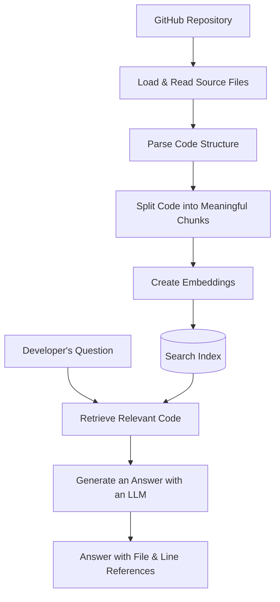
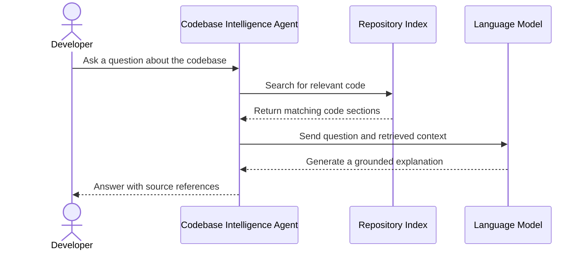

# How Codebase Intelligence Agent Works

Codebase Intelligence Agent helps developers understand unfamiliar codebases by answering questions about a repository and showing where the relevant information comes from.

## Workflow

## What Happens When You Ask a Question?

## Key Idea

Instead of asking an AI model to guess how a project works, the agent first searches the repository for relevant code and uses that evidence to build its answer. File and line references help developers verify the explanation themselves.
